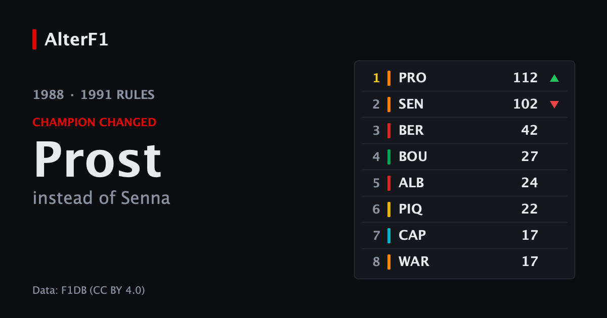

# AlterF1

[](https://github.com/MSheker20/AlterF1/actions/workflows/ci.yml)
[](LICENSE)
[](https://github.com/f1db/f1db)

**What if the 1988 title had been decided under 1991 rules?** AlterF1 replays every Formula 1 season
since 1950 under five historical points systems and shows who would have been champion.



## What changes

| Season | Real champion | Under another system |
| --- | --- | --- |
| 1964 | John Surtees (40) | Graham Hill under 1991, 2003 and 2010 rules |
| 1986 | Alain Prost (72) | Nigel Mansell under 1950 rules |
| 1988 | Ayrton Senna (90) | Alain Prost under every other system (112 with 1991 rules) |
| 2008 | Lewis Hamilton (98) | Felipe Massa under 1950, 1961 and 1991 rules |
| 2016 | Nico Rosberg (385) | Lewis Hamilton under 1950, 1961 and 1991 rules |

The home page lists every season where the champion changes.

## Features

- **Five points systems:** `1950`, `1961`, `1991`, `2003` and `2010`. Inside its own era each system
  applies that season's exact rules (best-N results, split seasons, shared drives, fastest lap,
  sprints). Outside its era it applies its standard rules, with best-N scaled to the season length.
- **Drivers' and constructors' championships.** Teams are chassis + engine, as in the real
  championship (Cooper-Climax and Cooper-Maserati are separate). Constructors' rules follow the
  points system: only the best-placed car scores from 1958 to 1978, all cars from 1979. Seasons
  before 1958 show an alternative constructors' championship.
- **Scenarios:** remove drivers or races, turn sprint and fastest-lap points on or off, choose how
  half and double points apply, or build your own points system. Everything is in the URL, so any
  scenario can be shared.
- **Compare and progression:** a matrix of every system side by side, and a points-by-round chart
  that marks the race where the title was decided.
- **English and Turkish** (`/` and `/tr`), with a preview image for every shared season link.
- **Tested against history:** under its own era's system, every season reproduces the real
  drivers' standings (1950–today) and the real constructors' champion (1958–today).

## Stack

| Part | Technology |
| --- | --- |
| Backend | Java 26, Spring Boot 4.2 |
| Frontend | React 19, Vite 8, TypeScript, Tailwind CSS 4, Recharts, Motion |
| Database | PostgreSQL 18 with the [F1DB](https://github.com/f1db/f1db) dump |
| Tests | JUnit 5 + Testcontainers, Vitest + Testing Library, Playwright |
| Local run | Docker Compose |

```text
.
├── backend/              # Spring Boot API and scoring engine
├── frontend/             # React + Vite web app
├── infra/                # Docker Compose, F1DB loader, env template
├── docs/                 # README images
└── .github/workflows/    # CI (backend, frontend, end-to-end)
```

## Run locally

1. Create the environment file and set two local passwords:

   ```bash
   cp infra/.env.example infra/.env
   ```

   In `infra/.env`, replace `POSTGRES_PASSWORD=change-me` (owner role) and
   `ALTERF1_RO_PASSWORD=change-me-too` (read-only role used by the backend).

2. Start everything:

   ```bash
   docker compose -f infra/docker-compose.yml up --build
   ```

3. Open http://localhost:5173 (English) or http://localhost:5173/tr (Turkish).
   API health: http://localhost:8080/api/v1/health

### Develop without building images

```bash
cd backend && ./mvnw spring-boot:run      # API on :8080 (needs Postgres from compose)
cd frontend && npm ci && npm run dev      # web app on :5173
```

### Tests

```bash
cd backend && ./mvnw test      # unit tests, no Docker
cd backend && ./mvnw verify    # plus *IT tests against the real F1DB dump (needs Docker)
cd frontend && npm test        # component and unit tests
cd frontend && npx playwright install chromium && npm run e2e   # needs the compose stack running
```

Set `E2E_BASE_URL` to run the end-to-end suite against another URL (default `http://localhost:5173`).

## API

| Endpoint | Description |
| --- | --- |
| `GET /api/v1/seasons` | Seasons and their real champions |
| `GET /api/v1/systems` | The five points systems and their rules |
| `GET /api/v1/highlights` | Seasons where another system crowns a different champion |
| `GET /api/v1/seasons/{year}/standings` | Drivers' standings, races, headline and scoring notes |
| `GET /api/v1/seasons/{year}/compare` | Drivers ranked under every system |
| `GET /api/v1/seasons/{year}/progression` | Drivers' points by round and the deciding race |
| `GET /api/v1/seasons/{year}/constructors` | Constructors' standings (same shape, plus team rules) |
| `GET /api/v1/seasons/{year}/constructors/compare` | Constructors ranked under every system |
| `GET /api/v1/seasons/{year}/constructors/progression` | Constructors' points by round |
| `GET /og/season/{year}.png` | Preview image for a shared season |

Query parameters: `system`, `preset` (`historical` \| `pure` \| `all`), `exclude`, `skip`,
`sprint`, `fl`, and for a custom system `custom`, `customFl`, `customSprint`, `customBest`.
Errors use RFC 9457 Problem Details (`application/problem+json`).

## Data

The pinned F1DB release and its SHA-256 checksum are in `infra/f1db/f1db.env`. On
`docker compose up`, the one-shot `f1db-loader` service downloads the PostgreSQL dump, checks it
against the checksum, caches it and loads it into the `f1db` schema (skipped if that version is
already loaded). To upgrade, change `F1DB_VERSION` and `F1DB_SHA256`.

The backend reads through the read-only `alterf1_ro` role; Flyway uses the owner role to manage
the `alterf1` schema of views.

## License and attribution

The code is released under the [MIT License](LICENSE).

Race and championship data comes from [F1DB](https://github.com/f1db/f1db), licensed under
[CC BY 4.0](https://creativecommons.org/licenses/by/4.0/). The data is not covered by the MIT
License.

AlterF1 is an unofficial fan project and is not associated in any way with the Formula 1 group of
companies. F1, FORMULA ONE, FORMULA 1, FIA FORMULA ONE WORLD CHAMPIONSHIP, GRAND PRIX and related
marks are trademarks of their respective owners.
